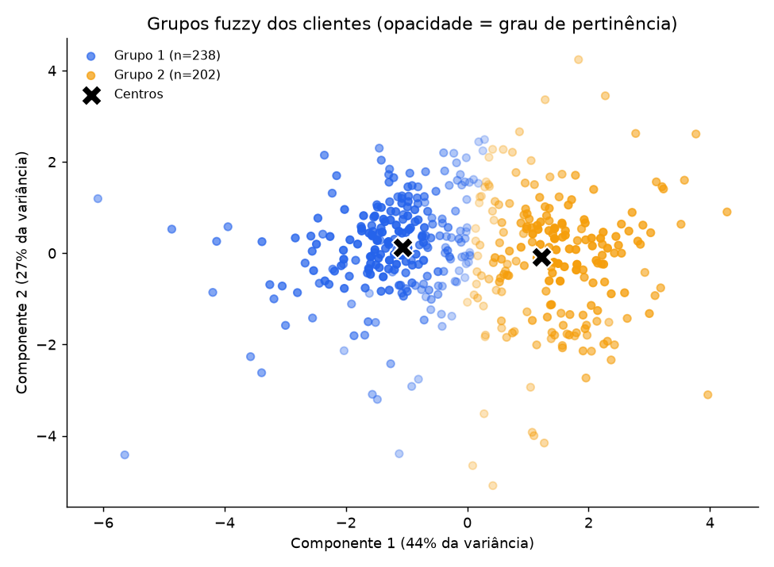

# Segmentação Fuzzy de Clientes Atacadistas

Aplicação de **lógica fuzzy** (algoritmo **Fuzzy C-Means**) em uma base de dados **não supervisionada**, a *Wholesale Customers* do repositório UCI, para agrupar clientes de um distribuidor atacadista de acordo com seus padrões de consumo.

Diferente de um agrupamento tradicional (como o k-means), em que cada cliente pertence a um único grupo, no Fuzzy C-Means cada cliente recebe um **grau de pertinência** a cada grupo. Isso permite identificar os clientes de **fronteira**, que têm perfil misto e seriam mal representados por uma classificação rígida.

## Duas versões do projeto

O projeto foi desenvolvido em duas versões que usam **o mesmo algoritmo e os mesmos dados**, mudando apenas a forma de apresentar os resultados:

| Versão | Arquivo | Para que serve |
|---|---|---|
| **Protótipo (terminal)** | `fuzzy_wholesale.py` | Executa o pipeline completo, imprime os resultados no terminal (CMD) e salva gráficos (`.png`), tabelas (`.csv`) e um resumo (`.txt`) na pasta `resultados_fuzzy/`. |
| **Aplicação interativa (Streamlit)** | `fuzzy_wholesale_app.py` | Interface web com gráficos **Plotly interativos**, geradas diretamente a partir dos dados lidos. Permite ajustar parâmetros, explorar os grupos, consultar clientes individualmente e baixar a tabela de pertinência. Também imprime os resultados no terminal. |

A versão de terminal é a mais simples para reproduzir e conferir os números. A versão com interface oferece uma visualização mais ampla e gráfica, indicada para apresentação e exploração.

## Sobre a base de dados

- **Fonte:** [UCI Machine Learning Repository, Wholesale Customers](https://archive.ics.uci.edu/dataset/292/wholesale+customers)
- **Tamanho:** 440 clientes, sem valores faltantes
- **Variáveis de gasto anual (usadas no modelo):** `Fresh` (frescos), `Milk` (laticínios), `Grocery` (mercearia), `Frozen` (congelados), `Detergents_Paper` (limpeza e papel) e `Delicassen` (delicatessen)
- **Variáveis categóricas (fora do modelo):** `Channel` (1 = Horeca, 2 = Varejo) e `Region` (1 = Lisboa, 2 = Porto, 3 = Outra)

### Por que o uso é não supervisionado

Não há variável-alvo. O algoritmo recebe apenas as 6 colunas de gasto e descobre os grupos sozinho. `Channel` e `Region` **não participam do treinamento**: são usadas somente ao final, como **validação externa**, para conferir se os grupos encontrados fazem sentido.

## Metodologia

1. **Pré-processamento:** transformação `log(1 + x)` seguida de padronização (z-score), porque os gastos são muito assimétricos e poucos clientes grandes dominariam o resultado.
2. **Fuzzy C-Means** implementado em NumPy (m = 2), com múltiplas inicializações e escolha da execução de menor função objetivo.
3. **Escolha do número de grupos (c = 2 a 8)** com quatro índices de validação: Coeficiente de Partição, Entropia de Partição, Índice de Xie-Beni e Silhueta.
4. **Análise de pertinência:** identificação dos clientes de fronteira (maior pertinência abaixo de 60%).
5. **Validação externa** comparando os grupos com `Channel` e `Region`.

## Principais resultados

Com a configuração padrão (m = 2), os índices indicaram **2 grupos**:

| Grupo | Clientes | Perfil de consumo |
|---|---|---|
| Grupo 1 | 238 | Maior gasto em Frescos e gasto muito baixo em Limpeza/Papel |
| Grupo 2 | 202 | Maior gasto em Laticínios, Mercearia e Limpeza/Papel |

- **Silhueta:** 0,285 | **Coeficiente de Partição:** 0,646 | **Entropia de Partição:** 0,532
- **Clientes de fronteira:** 81 (18,4%), com pertinência máxima abaixo de 60%
- **Validação externa:** o Grupo 1 é composto por 98,3% de clientes Horeca e o Grupo 2 por 68,3% de clientes de Varejo. Ou seja, o modelo recuperou o tipo de cliente sem nunca ter visto a coluna `Channel`.



## Estrutura do repositório

```
.
├── fuzzy_wholesale.py              # Versão protótipo (terminal)
├── fuzzy_wholesale_app.py          # Versão final (Streamlit + Plotly)
├── Wholesale_customers_data.csv    # Base de dados original (UCI)
├── requirements.txt                # Dependências
├── resultados_fuzzy/               # Saídas geradas pela versão de terminal
└── README.md
```

## Como executar

### 1. Instalar as dependências

Requer Python 3.9 ou superior.

```bash
pip install -r requirements.txt
```

### 2. Versão de terminal

```bash
python fuzzy_wholesale.py
```

No Windows, se `python` não funcionar, use `py fuzzy_wholesale.py`. Os resultados são impressos no terminal e salvos em `resultados_fuzzy/`.

### 3. Versão com interface (Streamlit)

```bash
streamlit run fuzzy_wholesale_app.py
```

O navegador abre automaticamente em `http://localhost:8501`. O arquivo `Wholesale_customers_data.csv` precisa estar na mesma pasta do programa (ou pode ser enviado pela barra lateral da interface).

> Execute os comandos a partir da pasta do projeto, para que o CSV seja encontrado.

## Funcionalidades da aplicação Streamlit

- **Visão geral:** indicadores principais e gráficos dos índices de validação, com a sugestão automática do número de grupos
- **Grupos:** dispersão 2D/3D (PCA) colorida por grupo dominante ou pela pertinência a um grupo específico, e perfil de consumo de cada grupo (com opção de escala logarítmica)
- **Pertinência:** distribuição da nitidez dos grupos, funções de pertinência, mapa de calor dos clientes mais ambíguos e consulta individual de qualquer cliente
- **Tabela:** tabela completa de pertinência com filtros e download em CSV
- **Interpretação:** leitura automática do perfil de cada grupo e validação externa com `Channel` e `Region`
- **Parâmetros ajustáveis:** variáveis usadas, fuzzificador *m*, número de grupos (automático ou manual) e limiar de fronteira

## Tecnologias

Python · NumPy · pandas · scikit-learn (PCA e silhueta) · Matplotlib · Plotly · Streamlit

## Referência

Cardoso, M. G. M. S. (2013). *Wholesale customers* [Conjunto de dados]. UCI Machine Learning Repository.

## Autor

**Enzo Fernandes** · Ciência de Dados, FATEC Cotia · [@enzofernandes-ds](https://github.com/enzofernandes-ds)
